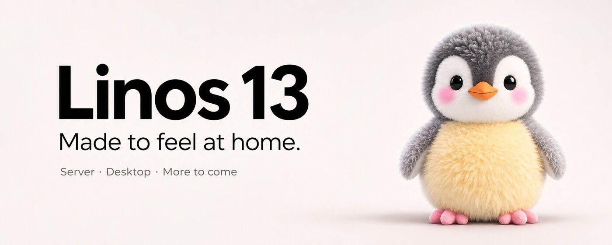

<div align="center">

**Linux, made for the people who use it.**

Linux has the capability. Linos is about making that capability feel natural, dependable and genuinely welcoming to everyday users.

**Linos 13 · Server development preview · Generation 1.0.0**

[Why Linos exists](docs/vision.md) · [Product](PRODUCT.md) · [Master plan](docs/plans/linos13-master-plan.md) · [Architecture](docs/architecture/overview.md) · [Builds & tests](https://github.com/phe-rus/linos/actions) · [Get involved](https://github.com/phe-rus/linos/issues)

</div>

---

### Linux should feel like home.

Linux is enormously capable, but capability alone does not make a system one that ordinary people can comfortably choose. Linos is being built to close that gap. We want the care, consistency, clarity and responsiveness people expect from mainstream consumer operating systems, without asking everyone to become technically proficient first.

Linos is **not intended to be a Debian spin or a conventional Linux distribution with a different skin**. We initially draw software from stable upstream repositories, but the operating-system structure, kernel policy, app experience, developer tools, updates and interactions are intended to be designed and validated as Linos. Those independent layers remain under development. Linos kernel packages derived from verified Linux 6.18.63 have passed AMD64 and ARM64 QEMU tests, including installed Server boots and identity-persistence recovery. Debian continues to supply much of the initial userspace.

Our long-term target is a first-class **Rust-native application platform**, a full **Assets** file manager, **Linus store** for developers and users, and a repeatable Linos kernel and performance contract. Those goals are not features already shipped.

Linos is intended as a family of experiences for everyday devices. **Server** is the first edition in development, not the limit of the vision. Desktop and other device experiences follow as the common platform matures. The [shared Rust platform and Desktop execution plan](docs/architecture/desktop-platform.md) defines common edition, recovery and boot contracts.

We want the experience to feel considered from power-on to daily use: a clear recovery environment, approachable setup, dependable updates and a system that remains useful without a cloud account.

> **Early development preview:** Server boots in virtual machines, but Linos is not ready to install on your personal computer or production server. Physical-disk installation is deliberately disabled.

### One platform. Different experiences.

| Server | Desktop | Beyond |
| :--- | :--- | :--- |
| **In active development** | **Planned next** | **Future exploration** |
| A clean, capable CLI and recovery experience for servers, VMs and supported boards. | A graphical operating system with a distinct Linos interface and applications. | Device-specific systems for mobile and other form factors. |

The edition is defined by the installation media. Setup is tailored to the device, not used as an edition selector.

### Real progress, tested continuously.

**Observed or tested**

- amd64 and arm64 Server images boot in QEMU.
- First-boot Cliclack enrollment and remembered-user sign-in using PAM, demonstrated in QEMU.
- Adaptive Server Home, navigation palette, read-only Assets browser and live Resources view in QEMU screenshots.
- Persistent PTY-backed Linux command handling, with an outstanding reported false-password-prompt bug.
- amd64 UEFI firmware boot and independent Server Recovery.
- Read-only hardware inspection, GPT layout validation and offline payload creation.
- Disposable virtual-disk installation simulation that boots the installed system.

**Still in progress**

- Authenticated offline installer media and complete recovery workflows.
- Safe installation onto real devices, A/B updates and rollback.
- Correct embedded prompt/password handling and complete controlled Settings interactions.
- Hardware awareness (new source, QEMU validation pending), Linus store inventory/search/simulation (new source, validation pending), physical hardware support beyond QEMU.
- Production kernel release, verified updates/rollback, hardware qualification and performance regression budgets.

Linos kernel 1.0.0 development candidates based on Linux 6.18.63 and Debian 13 (Trixie) packages currently provide the bootstrap foundation. Linos-specific services and tools are being developed in Rust. We maintain an experimental Linos kernel with Linos-owned source additions. We do not claim physical hardware certification, an independent package repository, or a finished installer.

### A recovery system that belongs there.

Our target UEFI installation layout separates **EFI**, **Recovery**, **System A**, **System B** and **Data**. Recovery uses a dedicated console on Server and will have a graphical experience on Desktop. This is a design in progress, not a claim that every current image already uses the finished partition scheme.

### Build it. Explore it.

Run from a suitable Debian-based build environment with the required dependencies installed:

```bash
./build/package.sh
./build/image.sh
./tests/server.sh smoke amd64
```

For Rust checks:

```bash
cargo fmt --all -- --check
cargo clippy --workspace --all-targets --locked -- -D warnings
cargo test --workspace --locked
```

See the build scripts and GitHub Actions workflow for full prerequisites and architecture-specific tests. For a new development image use `bash build/image.sh next amd64` before building. Images already assembled do not change when source code changes. Never run installer experiments against disks containing data; the present integration tests use disposable virtual disks.

### From the vision to a working operating system.

Linos development is guided by a [durable product definition](PRODUCT.md), a [staged master plan](docs/plans/linos13-master-plan.md) and a [proposed repository structure](docs/architecture/proposed-repository-structure.md). These are separate from the existing implementation: the current Server works in QEMU, while kernel ownership, native Rust applications and a managed software platform are still being designed and tested.

We use the [Impeccable](https://github.com/pbakaus/impeccable) design workflow for product context and focused UX review. The initial `PRODUCT.md` is in place. `DESIGN.md` will be created only after documenting and critiquing the existing Linos interface, not by inventing a new visual system.

The release gates are evidence-based: development preview, alpha, beta and stable each have different requirements. The [current status](docs/architecture/current-status.md) tracks what is demonstrated and what still blocks a release.

### Where we're going.

1. **Foundation:** bootable Server images, persistent identity, first-boot enrollment and CI tests.
2. **Recovery and installer:** standalone Recovery, verified payloads, offline installation and guarded disk operations.
3. **Server experience:** secure installation, system updates, recovery operations, services, and friendly CLI management.
4. **Desktop:** graphical environment and hardware-specific editions.
5. **Beyond desktop:** mobile and other supported device families, with their own boot and recovery requirements.

The [architecture roadmap](docs/architecture/roadmap.md) distinguishes validated functionality from designs and future goals. The [current engineering status](docs/architecture/current-status.md) records completed stages, unverified features, blockers and alpha release gates. Contributions and issue reports are welcome.

### Yours, by default.

Offline device setup comes first. Integration with **Passid** (`passid`) and optional device-finding through **passme** will be opt-in. Linos should remain usable without a cloud account.

---

<div align="center">**Linos 13** · Made to feel at home. 🐧</div>

### Rust efficiency for smaller development devices

Local Rust builds default to two concurrent compiler jobs via `.cargo/config.toml`.
Release Server packages compile only the four executables they install.
The `rust:measure` commit marker runs independent CI to record compiler RAM,
wall-clock build time and installed binary sizes; the Desktop graphics adapter
is checked separately and is not bundled into Server.
