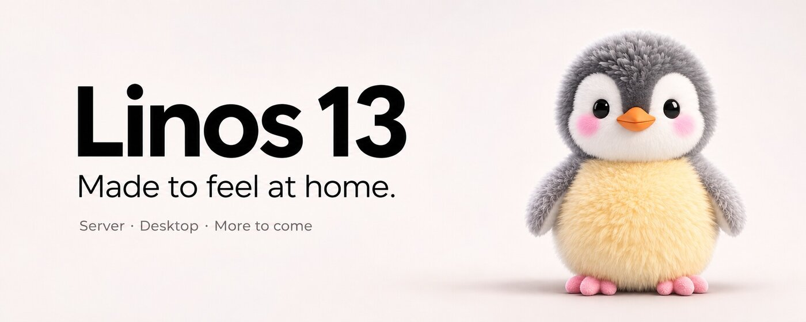

<div align="center">

**An operating system that feels like it belongs to you.**

Made for the server today. Designed for the desktop tomorrow. Built openly for what comes next.

**Marauder · Sequence 9 · Development generation 1.0.0**

[Explore Linos](docs/architecture/overview.md) · [See our progress](docs/architecture/roadmap.md) · [Builds & tests](https://github.com/phe-rus/linos/actions) · [Get involved](https://github.com/phe-rus/linos/issues)

</div>

---

### Thoughtful from the first boot.

Linos is a family of operating systems with a shared foundation and experiences shaped for each device. **Server** is the first edition. **Desktop** follows, with other hardware families planned later.

We want the experience to feel considered from power-on to daily use: a clear recovery environment, approachable setup, dependable updates and a system that remains useful without a cloud account.

> **Early development preview:** Server boots in virtual machines, but Linos is not ready to install on your personal computer or production server. Physical-disk installation is deliberately disabled.

### One platform. Different experiences.

| Server | Desktop | Beyond |
| :--- | :--- | :--- |
| **In active development** | **Planned next** | **Future exploration** |
| A clean, capable CLI and recovery experience for servers, VMs and supported boards. | A graphical operating system with a distinct Linos interface and applications. | Device-specific systems for mobile and other form factors. |

The edition is defined by the installation media. Setup is tailored to the device, not used as an edition selector.

### Real progress, tested continuously.

**Working and tested**

- amd64 and arm64 Server images boot in QEMU.
- First-boot console enrollment and persistent device identity.
- amd64 UEFI firmware boot and independent Server Recovery.
- Read-only hardware inspection, GPT layout validation and offline payload creation.
- Disposable virtual-disk installation simulation that boots the installed system.

**Still in progress**

- Authenticated offline installer media and complete recovery workflows.
- Safe installation onto real devices, A/B updates and rollback.
- A polished interactive Server experience and hardware validation beyond QEMU.

The Linux kernel and Debian 13 (Trixie) packages currently provide the bootstrap foundation. Linos-specific services and tools are being developed in Rust. We do not yet claim our own kernel, independent repository or finished installer.

### A recovery system that belongs there.

Our target UEFI installation layout separates **EFI**, **Recovery**, **System A**, **System B** and **Data**. Recovery uses a dedicated console on Server and will have a graphical experience on Desktop. This is a design in progress, not a claim that every current image already uses the finished partition scheme.

### Build it. Explore it.

Run from a suitable Debian-based build environment with the required dependencies installed:

```bash
./build/package.sh
./build/image.sh
./build/smoke.sh amd64
```

For Rust checks:

```bash
cargo fmt --all -- --check
cargo clippy --workspace --all-targets --locked -- -D warnings
cargo test --workspace --locked
```

See the build scripts and GitHub Actions workflow for full prerequisites and architecture-specific tests. Never run installer experiments against disks containing data; the present integration tests use disposable virtual disks.

### Where we're going.

1. **Foundation:** bootable Server images, persistent identity, first-boot enrollment and CI tests.
2. **Recovery and installer:** standalone Recovery, verified payloads, offline installation and guarded disk operations.
3. **Server experience:** secure installation, system updates, recovery operations, services, and friendly CLI management.
4. **Desktop:** graphical environment and hardware-specific editions.
5. **Beyond desktop:** mobile and other supported device families, with their own boot and recovery requirements.

The [architecture roadmap](docs/architecture/roadmap.md) distinguishes validated functionality from designs and future goals. Contributions and issue reports are welcome.

### Yours, by default.

Offline device setup comes first. Integration with **Passid** (`passid`) and optional device-finding through **passme** will be opt-in. Linos should remain usable without a cloud account.

---

<div align="center">**Linos 13** · Made to feel at home. 🐧</div>
